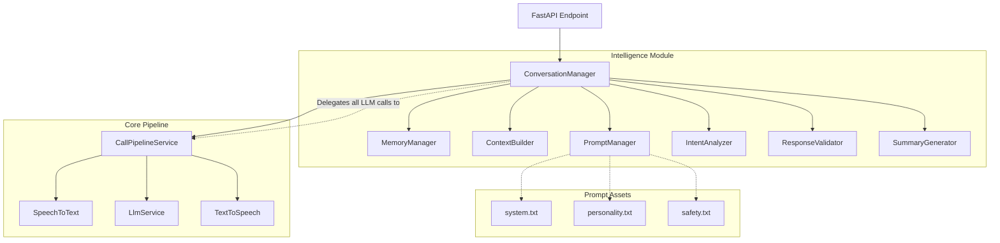

# Conversation Intelligence Engine

CHAYA's Conversation Engine transforms raw speech into contextually aware, intelligent dialogue. It sits as an orchestration layer between the API and the AI Pipeline.

## Architecture

The engine is built on Clean Architecture principles, completely abstracting away provider-specific implementations (e.g., Whisper, Gemini, ElevenLabs).

## Data Flow & Conversation State

Every incoming audio request steps through the `ConversationState` machine:

1. **IDLE**: Awaiting request.
2. **LISTENING**: The `ConversationManager` calls `CallPipelineService.transcribe()` to convert audio bytes into text.
3. **THINKING**:
    - **Memory Retrieval**: Fetches the conversation history.
    - **Intent Detection**: On the first turn, parses the user's intent.
    - **Context Assembly**: Compiles history and user profile into `ConversationContext`.
    - **Prompt Construction**: Merges context with `app/prompts/*.txt` rules.
4. **RESPONDING**:
    - Generates raw text via `CallPipelineService.generateResponse()`.
    - `ResponseValidator` checks for safety and length constraints.
    - Converts text to speech via `CallPipelineService.synthesizeSpeech()`.
5. **COMPLETED**:
    - Records the turn in the `MemoryManager`.
    - Generates a call summary.
    - Returns the audio payload and metadata to the client.

## Memory Flow

Memory is governed by the `MemoryManager` and stored via the `MemoryStore` protocol. 
Currently backed by an `InMemoryMemoryStore`, memory tracks:
- `ConversationTurn` logs (transcript, latency, timestamps).
- `CallerProfile` (name, phone, company).
- `ConversationSummary` (intent, priorities).
- `memory_version` for future database schema evolution.

## Prompt Construction

The `PromptManager` dynamically reads raw templates from `app/prompts/` on the fly, eliminating hardcoded string literals from the source code. It injects dynamic properties (like caller info and history) without requiring backend recompilation.

## Intent Detection

On the very first conversational turn, the `IntentAnalyzer` submits the user's transcript to an LLM evaluator using a dedicated prompt (`intent.txt`). It expects a strict JSON return representing:
- `intent` (e.g., HR, SPAM, JOB_INTERVIEW)
- `confidence` (0.0 to 1.0)
- `priority`

## Summary Generation

When the conversation updates, the `SummaryGenerator` collapses the full history into a concise `ConversationSummary` object containing the underlying objective, actionable next steps, and callback flags.

## Configuration

All limits and thresholds are highly configurable via `app/core/config.py`:
- `conv_max_history_turns`: 10
- `conv_intent_confidence_threshold`: 0.7
- `conv_max_response_length`: 1000 characters
- `conv_fallback_response`: A configurable safe default string if the LLM output fails validation.
