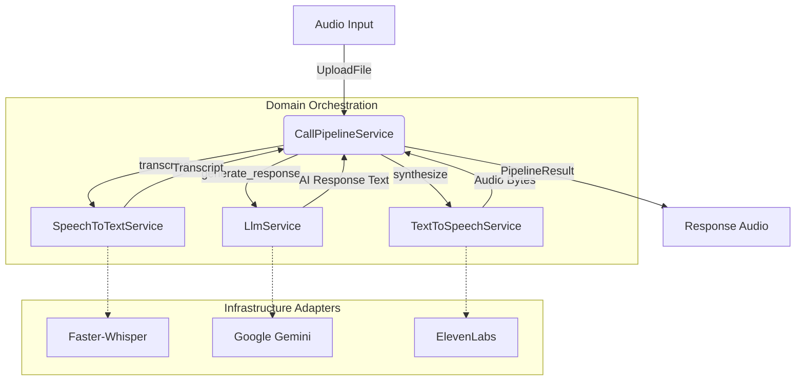

# AI Call Pipeline

The AI Call Pipeline orchestrates the sequence of events required to process an audio input, generate an intelligent response, and convert that response back into audio.

## Architecture

The pipeline follows **Clean Architecture** principles. The orchestration logic resides entirely in the **Domain Layer**, depending only on interface definitions (`typing.Protocol`). The actual service implementations reside in the **Infrastructure Layer**.

## Phase 2: Synchronous Execution (Current V1)

In the current version, the pipeline executes synchronously:
1. Wait for complete audio upload.
2. `SpeechToTextService`: Transcribe the full audio payload.
3. `LlmService`: Wait for the complete text response from the LLM.
4. `TextToSpeechService`: Generate the complete audio payload for the text.
5. Return the audio file.

## Phase 3/4: Future Streaming Support (Planned V2)

The architecture and the `typing.Protocol` interfaces are already designed to support asynchronous streaming (`AsyncIterator`). In future phases, this pipeline will be upgraded to use a streaming connection (e.g., WebSockets) to reduce time-to-first-byte (TTFB).

## Error Handling

Errors from third-party services (e.g., API timeouts, token limits) are caught within their respective adapters and translated into a generic `AiServiceError`. 
The `CallPipelineService` catches these and wraps them in a `PipelineError`, retaining the exact stage (`stt`, `llm`, `tts`) where the failure occurred. This guarantees that infrastructure concerns never leak into the API or domain layers.

## Logging

`structlog` is used extensively throughout the pipeline. Every request is tracked with a unique `request_id`.
We explicitly log:
- `pipeline_stage_started`: When a specific service is invoked.
- `pipeline_stage_completed`: The execution time and success state.
- `pipeline_stage_failed`: The execution time, provider, and failure reason.

> [!WARNING]
> We **never** log sensitive user data (audio data, transcripts) or API keys. Logs are strictly for tracing operational performance and error states.
