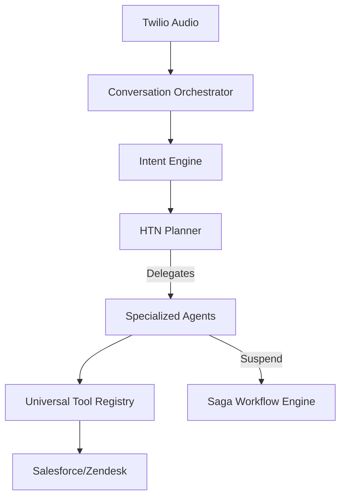

# CHAYA v1.0 Architecture Guide

This document serves as the master blueprint for the CHAYA v1.0 Enterprise AI Platform.

## 1. Core Principles
- **Clean Architecture:** Domain logic is completely isolated from infrastructure, web frameworks (FastAPI), and third-party APIs.
- **CQRS & Event Sourcing:** The system state is derived from an append-only `EventStore`. Write operations (Commands) emit Domain Events. Read operations (Queries) hit optimized Read Models (PostgreSQL).
- **Dependency Inversion:** Repositories, AI Providers, and Third-Party Integrations are injected via abstract Protocols.

## 2. Intelligence Pipeline

## 3. Data layer
- **PostgreSQL:** Stores Read Models (`caller_profiles`, `agent_profiles`) and the `EventStore`.
- **Redis:** Manages ephemeral `ConversationSession` state and `AgentCollaborationBus` pub/sub.
- **pgvector:** Powers the `SemanticCache` for AI cost optimization.

## 4. Compliance & Security
To satisfy GDPR without violating the immutable nature of Event Sourcing, CHAYA implements **Crypto-Shredding**. Every caller's PII is encrypted with a unique key. Executing a Right-to-Delete simply destroys this key in the Key Management Service, permanently anonymizing the ledger.

## 5. Deployment Topology
CHAYA is designed for multi-region active-active deployments.
- **API Nodes:** Stateless FastAPI containers behind a Global Load Balancer.
- **Worker Nodes:** Celery/ARQ workers sharded by tenant/region.
- **Database:** Multi-region PostgreSQL replication.
